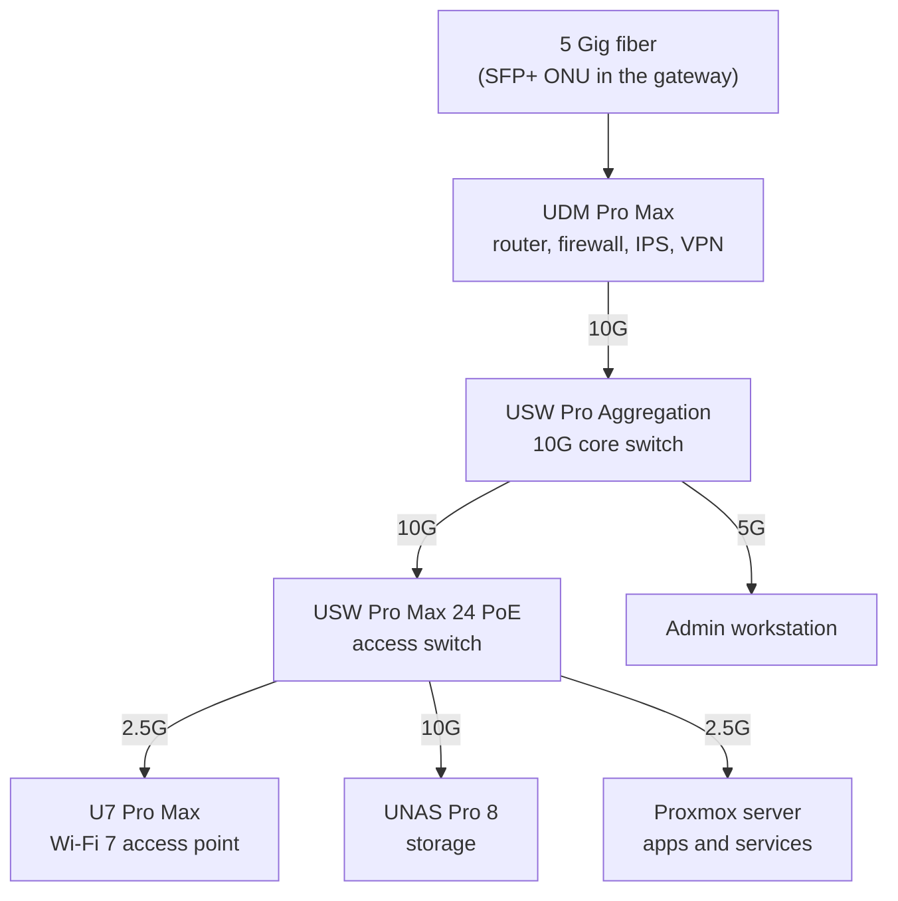
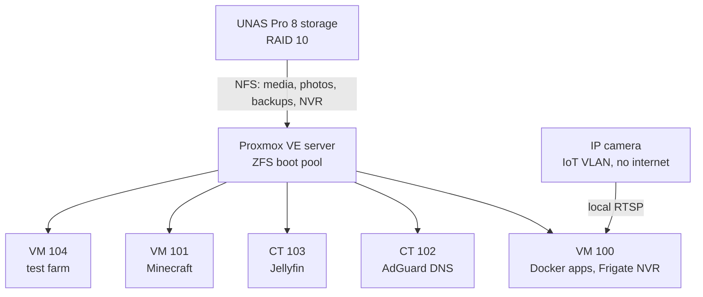
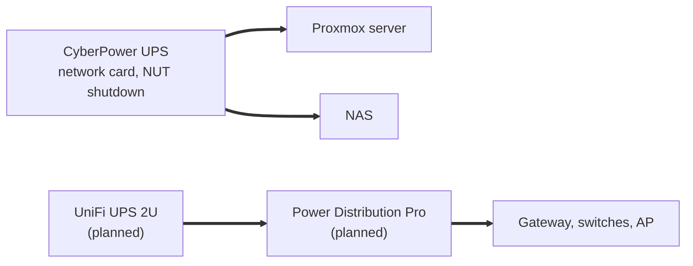

# Homelab: segmented network, Proxmox virtualization and self-hosted services

I designed, built and run a home lab on a 5 Gig fiber line. It has a UniFi zone-firewall network with eight VLANs, a Proxmox VE host on ZFS that runs Docker, LXC containers and VMs, a 48 TB RAID 10 NAS, and a UPS that shuts everything down in order. It hosts a media server with GPU transcoding, a private photo library, network-wide DNS filtering, a reverse proxy that gives internal web services real TLS certificates, WireGuard remote access, and public game servers isolated in their own zone. Monitoring and dead-man's-switch alerting watch all of it. The build started in early September 2026. This repo records every real step I took and every problem I fixed, with the evidence that each fix worked.

All names, addresses and identifiers in this repo are sanitized. The domain is shown as `example.com`, and addresses are shown as placeholders or by VLAN name.

## Contents

| Document | What it covers |
|---|---|
| [docs/build-log.md](docs/build-log.md) | Dated timeline of everything built, configured or changed |
| [docs/troubleshooting.md](docs/troubleshooting.md) | Every real problem fixed: symptom, investigation, root cause, fix, verification, lesson |
| [docs/network.md](docs/network.md) | WAN, VLANs and zones, DNS filtering and forcing, Wi-Fi, switching |
| [docs/proxmox-and-services.md](docs/proxmox-and-services.md) | Hypervisor, guests, Docker stacks, reverse proxy, each service |
| [docs/storage-and-backups.md](docs/storage-and-backups.md) | ZFS, NAS layout, NFS and SMB, backups, snapshots, restore drill |
| [docs/power-and-ups.md](docs/power-and-ups.md) | UPS, NUT over SNMPv3, ordered shutdown chain, power recovery |
| [docs/remote-access-and-security.md](docs/remote-access-and-security.md) | WireGuard, admin access, MFA, certificates, secrets, reviews |
| [docs/local-nvr.md](docs/local-nvr.md) | Turning a cloud IP camera into a fully local NVR: isolation, Frigate, go2rtc, MQTT alerts |

## Hardware

| Role | Device | Notes |
|---|---|---|
| Internet | 5 Gig fiber, XGS-PON | ISP gateway bypassed: an SFP+ ONU module sits directly in the router's WAN port. Router speed test 3.69 Gbps down, 5.01 Gbps up |
| Router and firewall | UniFi Dream Machine Pro Max | Zone-based firewall, IPS, WireGuard server, DDNS, local DNS records |
| Core switch | UniFi USW Pro Aggregation | 10G SFP+ backbone |
| Access switch | UniFi USW Pro Max 24 PoE | 2.5G PoE++ ports, 10G SFP+ uplinks, 400 W PoE budget |
| Wi-Fi | UniFi U7 Pro Max | Wi-Fi 7, 2.5G uplink, ceiling mounted |
| Hypervisor | Custom server: AMD Ryzen 7 9800X3D, 64 GB DDR5, ASUS X870E board, 1 TB NVMe | Proxmox VE 9 on ZFS. The Radeon iGPU is passed to the media container. Onboard Realtek RTL8126 5GbE NIC |
| NAS | UniFi UNAS Pro 8 | 4x 24 TB 7200 RPM in RAID 10 (about 48 TB usable), 10G SFP+, four bays free |
| UPS | CyberPower CP1500PFCRM2U (1500 VA / 1000 W) with RMCARD205 network card | Monitored by NUT over SNMPv3. Bought used and factory reset |
| Second UPS and PDU | UniFi Power Kit (UniFi UPS 2U plus Power Distribution Pro) | Bought. Plan: network gear on this UPS, servers on the CyberPower |
| Travel router | GL.iNet GL-BE3600 (Slate 7) | WireGuard client back to home, with a guest network kept out of the tunnel |
| MFA | 2x YubiKey 5C NFC | WebAuthn for the hypervisor's root login |

## Architecture

### Network

### Servers and services

### Power

### VLANs and firewall zones

| Zone | What lives there |
|---|---|
| Management | Network gear and the UPS network card |
| Server | The Proxmox server, its guests and the NAS |
| Server Admin | Admin access to servers and network gear |
| Trusted | Household phones and computers |
| IoT | Smart-home devices |
| Guest | Internet only, clients isolated from each other |
| Minecraft | The public game server, isolated from everything else |
| VPN | Remote WireGuard clients |
| BlackList | Unused switch ports, no access |

Design rules that shaped it:

- **Segmentation first.** Every class of device has its own VLAN and firewall zone. New zones default to block. Household devices on Trusted reach only the reverse proxy, Home Assistant and DNS on the Server VLAN. Admin pages need the Server Admin VLAN or the VPN.
- **One front door for web services.** Every web service sits behind Nginx Proxy Manager with one wildcard Let's Encrypt certificate issued through DNS-01. Internal names resolve only inside the house.
- **Infrastructure apart from apps.** DNS runs in its own small container, not on the Docker VM, so editing a compose stack cannot take down name resolution.
- **The only forwarded ports are the game servers'.** The game VM sits alone in its own zone with no path into the Server or Trusted VLANs. The only other open port is the gateway's own WireGuard server.

## Services

| Service | Where | Purpose |
|---|---|---|
| AdGuard Home | LXC (CT 102) | Network-wide DNS filtering with DNS-over-HTTPS upstreams. Every client VLAN is forced through it with NAT redirects and port 53/853 blocks. Internal names are DNS rewrites here |
| Nginx Proxy Manager | Docker on VM 100 | Reverse proxy for all web UIs, wildcard TLS via Cloudflare DNS-01, per-host access list for admin pages |
| Jellyfin | LXC (CT 103) | Media server. AMD iGPU passed through for VAAPI hardware decode and encode. Media mounted read-only |
| Immich | Docker on VM 100 | Phone photo backup. Library on the NAS over NFS, Postgres on local SSD, nightly database dumps |
| Home Assistant | Docker on VM 100 | Smart-home control with local Tuya control for wall switches |
| Uptime Kuma | Docker on VM 100 | Service monitors (HTTP, DNS, ping, TCP, push) with Discord alerts |
| Dockge | Docker on VM 100 | Compose stack manager |
| Actual Budget | Docker on VM 100 | Self-hosted budgeting, reachable only through the proxy |
| Minecraft Java and Bedrock | Docker on VM 101 | Modded Forge 1.12.2 server (about 190 mods) and a vanilla Bedrock server, whitelisted, in an isolated public zone |
| Test farm | VM 104 | Headless Godot test runner for a personal game project. Results land on the NAS |
| WireGuard | UDM | Remote access for a phone and the travel router |
| Frigate NVR | Docker on VM 100 | Local NVR for an IP camera: records to the NAS over NFS, go2rtc HD live view over MSE, CPU person detection. See [docs/local-nvr.md](docs/local-nvr.md) |
| mosquitto MQTT | Docker on VM 100 | Broker for Frigate events; a small notifier turns person detections into a push alert |

## Security and privacy

- **Zone firewall with least privilege.** Narrow allow rules, blocks on new and invalid connections only, return traffic handled by stateful allows. Unused switch ports sit on an isolated BlackList VLAN with PoE off. Trunks carry only the VLANs each device needs.
- **DNS that cannot be bypassed.** DHCP hands out AdGuard, NAT redirects catch hardcoded resolvers, port 853 is blocked, and a DoH-bypass blocklist removes public DoH resolvers. Upstreams are DoH only and there is no plaintext fallback.
- **Minimal internet exposure.** Only the two game ports are forwarded, plus the gateway's WireGuard port for remote access. UPnP is off. A passive outside check showed nothing else open (WireGuard does not answer unauthenticated packets). Internal hostnames were removed from public DNS.
- **Strong admin access.** Hypervisor web login has two-factor (YubiKey WebAuthn, TOTP, paper recovery keys) and SSH is key-only. Admin web pages are behind an IP access list on the proxy and are not published on host ports.
- **Secrets handled as secrets.** Scoped API tokens, one per consumer, IP-restricted where possible. Secrets live in root-only files and are never printed. Leaked credentials were revoked and replaced (see troubleshooting).
- **Domain hygiene.** SPF `-all`, DMARC `p=reject`, null MX, CAA limited to Let's Encrypt. DNSSEC is signed and validating (the DS record is published at the registry and the chain checks out).
- **Patching.** Every Debian guest gets automatic security updates only, with manual reboots. Container images are pinned to exact versions and upgraded on purpose.
- **Privacy.** Tracker lists in AdGuard, a 14-day query log, telemetry reduced, and outbound traffic for two VLANs routed through a commercial WireGuard VPN on a schedule.

Details: [docs/remote-access-and-security.md](docs/remote-access-and-security.md) and [docs/network.md](docs/network.md).

## Backups and power protection

- Nightly Proxmox backups (snapshot mode, zstd) of every guest that holds state, to the NAS over NFS, with a 7 daily, 4 weekly, 3 monthly retention.
- Immich database dumps every night at 02:00, checked daily for age, size and gzip integrity.
- Daily NAS snapshots on every share, with limits tuned per share.
- A restore drill to a spare ID passed (257 MiB/s, link limited).
- The UPS shutdown chain stops the VMs and AdGuard in order, releases NFS mounts, powers off the NAS over SSH and halts the host, which also stops the Jellyfin container. A real pull-the-plug drill finished in 26 seconds against a 10-minute budget. The test farm step was added after that drill and has not been drilled yet.
- Guests auto-start in dependency order after power returns. BIOS restore-on-power-loss is on.

Details: [docs/storage-and-backups.md](docs/storage-and-backups.md) and [docs/power-and-ups.md](docs/power-and-ups.md).

## Monitoring and alerting

| Source | How it alerts |
|---|---|
| Proxmox (backups, storage, ZFS events) | Notification system to a Discord webhook. Backup notices use a short template so they fit Discord's limit |
| UPS | NUT notify script to Discord, with a re-check that keeps false low-battery readings on mains out of the channel |
| Services | Uptime Kuma HTTP, DNS, ping, TCP and push monitors |
| Dead-man's switches | healthchecks.io checks for the nightly backup, the Immich dump, the test farm and a 5-minute "host alive" heartbeat |
| Host network link | A per-minute check of loss and latency to the gateway, with a "was bad from X to Y" summary when the alert could not get out at the time |
| Container disk | A push monitor that alerts at 85% on the media container's disk |
| Network devices | UniFi device-offline push alarms, including a mobile alert if the server or NAS drops off the network |
| Camera | Person-detection push alert from the local NVR ([docs/local-nvr.md](docs/local-nvr.md)) |

## Highlights: problems I solved

1. [Server 5GbE link dropping through a copper SFP+ module](docs/troubleshooting.md#1-server-5gbe-link-drops-through-a-copper-sfp-module): traced rx errors to the host side, moved to a clean 2.5G port, planned an SFP+ NIC with a DAC.
2. [Jellyfin playback pausing until a refresh](docs/troubleshooting.md#2-jellyfin-playback-pauses-until-a-page-refresh): transcode segments filled the container disk; fixed and verified on a 31-minute 4K transcode.
3. [Docker containers with no DNS and a silently missing NFS mount](docs/troubleshooting.md#3-docker-dns-failures-and-the-boot-race): one boot race behind both; fixed the cause, not the symptoms.
4. [VM that could never reboot](docs/troubleshooting.md#4-vm-hangs-forever-on-reboot-qxl): a qxl display driver hang on Debian 13 that would also have stalled the UPS shutdown chain.
5. [UPS shutdown chain built and drilled on a real power cut](docs/troubleshooting.md#5-ups-shutdown-chain-and-the-killpower-investigation): 26 seconds end to end, plus a four-attempt investigation into why the UPS card ignores power-off commands.
6. [Proxmox had never sent a single alert, then a mail bounce loop](docs/troubleshooting.md#6-proxmox-never-sent-an-alert-then-a-bounce-loop): built the Discord path, found and closed the loop.
7. [Guest Wi-Fi had no DNS for 41 days, and DNS redirects never redirected](docs/troubleshooting.md#7-guest-vlan-had-no-dns-for-41-days): rule order and a NAT interface bug, both fixed and proven.
8. [Wi-Fi "dead zone" that was really a 6 GHz problem, and a cable that failed 2.5G](docs/troubleshooting.md#8-poor-wi-fi-coverage-was-a-6-ghz-band-problem): read the client list before measuring anything.
9. [Leaked API token cleanup](docs/troubleshooting.md#9-leaked-api-token-and-credential-cleanup): replaced a printed Cloudflare token without breaking certificate renewal, then split tokens per consumer.
10. [Intrusion prevention silently dropping an internal service](docs/troubleshooting.md#10-ips-silently-dropping-one-tcp-port): tcpdump proved packets never arrived; ping working while one port dies means IPS before firewall.

The full list (over 30 entries) is in [docs/troubleshooting.md](docs/troubleshooting.md).

## Skills shown

- **Virtualization:** Proxmox VE, KVM VMs and LXC containers, VLAN-aware bridges, cloud-init images, guest agent, iGPU device passthrough, boot order and resource tuning
- **Storage:** ZFS (scrub, trim, quotas, resize), RAID 10 design, NFS squash and export design, SMB, snapshots, retention policy, restore testing
- **Linux administration:** Debian 13, systemd units and ordering, `network-online.target`, unattended-upgrades, needrestart, fstab, journald, cron
- **Containers:** Docker and Compose, image pinning by tag and digest, shared proxy networks, compose overrides, Docker DNS
- **Networking:** VLANs, trunks, zone-based firewall design, NAT, policy-based routing, ISP gateway bypass with an SFP+ ONU, 10G SFP+ and multi-gig copper, Wi-Fi 6E and 7 planning
- **DNS:** AdGuard Home, DoH upstreams, DNS forcing with DNAT and blocks, split-horizon names, DDNS, SPF, DMARC, CAA, DNSSEC
- **TLS and reverse proxy:** Let's Encrypt with DNS-01 (Cloudflare), wildcard certificates, Nginx Proxy Manager, access lists, WebSocket proxying
- **VPN and remote access:** WireGuard server and clients, travel router tunnel scoping, RDP with NLA and Duo
- **Identity and access:** WebAuthn (YubiKey), TOTP, key-only SSH, scoped API tokens, least-privilege service accounts
- **Power:** UPS sizing and runtime, NUT over SNMPv3, ordered shutdown automation, SNMP troubleshooting, power-loss recovery
- **Monitoring:** Uptime Kuma, healthchecks.io dead-man's switches, Proxmox notifications, ZFS ZED, Discord webhooks
- **Scripting:** Bash (alerting, health checks, UniFi API automation), Python (media library renames, token checks), PowerShell
- **Troubleshooting method:** tcpdump, ethtool counters, journal and audit-log timelines, hit counters, A/B isolation, drills that prove recovery
- **Documentation:** as-built docs, runbooks with rollback for every change, incident timelines, lessons learned

## How I work

I designed this lab and I own every decision in it. I used AI assistants (Claude Code) for research, for help writing scripts, for documentation and for read-only checks against live systems. Every change was shown to me with its rollback first, and was approved and applied under my direction. Read-only reviews were run before any batch of changes, and changes were made one at a time with a verification step after each.

## What's next

- Add an Intel SFP+ card (X710 class, not bought yet) to the server with a DAC to the aggregation switch, for a stable 10G host link.
- Re-check the access point's cable run: its port has fallen back to 1 Gbps.
- Install the UniFi Power Kit: network gear on the UniFi UPS, servers on the CyberPower, then re-measure load and re-drill the shutdown chain.
- Mirror the ZFS boot pool with a second NVMe.
- Add an offsite copy of the NAS (photos first).
- Move the Docker stacks and host configs into git with secret scanning and pinned-version update PRs.
- Add metrics and dashboards (Prometheus and Grafana) next to the existing alerting.
- Grow the NAS with four more 24 TB drives as a second RAID group.
