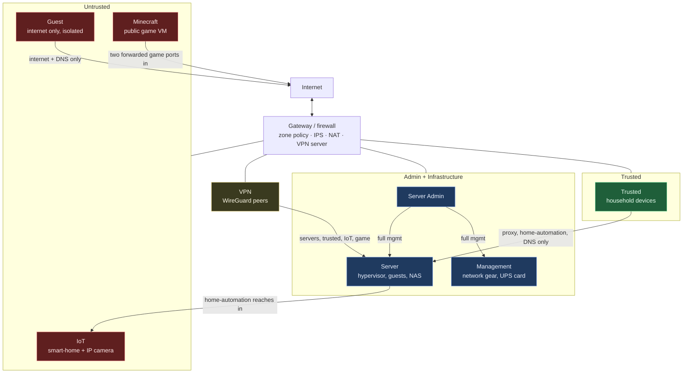

# Network segmentation and zone-based firewall design

This is a network-engineering view of the lab: how the network is divided into VLANs and firewall zones, how traffic between them is controlled under a default-deny posture, and how those controls were used to contain an untrusted device. It is written for a reader who cares about segmentation, least privilege and threat containment rather than the service catalog.

All names, addresses and identifiers are sanitized, as everywhere in this repo: the domain is `example.com`, and segments are named rather than numbered-with-real-subnets.

## Design goals

- **Segment by trust, not by convenience.** Every class of device sits in its own VLAN and its own firewall zone, so a compromise is contained to one segment instead of the flat LAN.
- **Default deny between zones.** Zones start with no inter-zone access. Reachability is added one narrow rule at a time, never opened broadly and trimmed later.
- **Least privilege east-west.** A device may reach only the specific hosts and ports it needs. "It works" is not the bar; the firewall's hit counters are.
- **Keep untrusted and IoT away from trusted and server traffic.** Guests, smart-home gear and a public game server must never have a path into the hosts that hold data or admin planes.
- **No silent bypass.** DNS, IPv6 and unused ports are all closed off so nothing routes around the policy.

## VLAN and zone layout

Each VLAN maps to its own custom firewall zone. New custom zones default to blocking everything except the internet and the gateway, which makes default-deny the starting point rather than an afterthought.

| VLAN | Zone | Trust tier | What lives there | DNS |
|---|---|---|---|---|
| Management | `mgmt` | Infrastructure | Switches, AP, gateway management, UPS network card | Gateway |
| Server | `servers` | Infrastructure | Hypervisor, its guests, the NAS | Gateway |
| Server Admin | `serveradmin` | Admin | The admin workstation (management plane) | Filtered |
| Trusted | `trusted` | Trusted | Household phones and computers | Filtered |
| IoT | `iot` | Untrusted | Smart switches, a hub, a voice assistant, an IP camera | Filtered |
| Guest | `guest` | Untrusted | Visitor devices, internet only, client isolation on | Filtered |
| Minecraft | `minecraft` | Untrusted (public) | One public game VM, alone in its own zone | Gateway |
| VPN | `vpn` | Remote | WireGuard peers | Filtered |
| BlackList | `blacklist` | Quarantine | Unused switch ports; no DHCP, no internet | none |

Design rationale per tier:

- **Infrastructure (Management, Server)** carries the hypervisor, storage and network gear. These segments use the gateway for DNS on purpose: the DNS filter is a guest on the hypervisor, so depending on it for the hypervisor's own resolution would create a cold-boot gap. Removing that circular dependency is a resiliency decision, not a filtering gap.
- **Admin (Server Admin)** is the only segment with broad management access to servers and network gear. Admin web UIs and SSH are reachable from here or over the VPN, nowhere else.
- **Trusted** household devices get a deliberately small reach into the Server zone: a reverse proxy on HTTPS, the home-automation UI, and DNS. Everything else, including every admin page, requires the Admin VLAN or the VPN.
- **Untrusted (IoT, Guest, Minecraft)** cannot initiate connections into any internal zone. IoT is reached *from* home automation, never the reverse. Guest is internet-only with client isolation. The public game VM sits alone in its zone with no east-west path at all.
- **Quarantine (BlackList)** is where every unused switch port lives: isolated VLAN, no tagged VLANs, PoE off. A port is explicitly provisioned before anything is plugged into it, so an opportunistic plug-in lands nowhere.

## Trust boundaries

The arrows are the only inter-zone paths that exist. Everything not drawn is denied by default. Untrusted zones have no arrow into any internal zone; the Minecraft zone's only connectivity is the two inbound game ports from the internet.

## Zone-based firewall policy

I describe the design rather than reproduce the rule table.

- **Default deny between zones.** Each allow rule names one source zone, one destination, and the fewest ports that work. There is no blanket inter-zone allow to narrow down later.
- **Stateful allows.** Allows match connection-state "all" with automatic return traffic, so the destination zone can answer but can never *initiate* back toward the source. A camera's live view works because the client opens the session and the reply rides the return path; no reverse rule from the untrusted side is needed.
- **Blocks scoped to new and invalid connections.** Deny rules match only new and invalid states, so they never tear down an established flow that an allow already permitted. State handling is explicit on both allows and blocks.
- **Order over specificity.** Policy order decides the outcome; a more specific rule placed below a broad block does nothing. The verification is the rule's hit counter, not whether an app happens to load.
- **One class of failure I watch for:** an allow that silently behaves like a timeout. It is almost always a block matching "all" states, return traffic left off, or rule order. Those cases and their fixes are written up in [troubleshooting entries 19 to 21](troubleshooting.md#19-proxmox-refused-a-new-admin-subnet).

Representative allow rules and why each exists:

| Source | Destination | Allowed | Why |
|---|---|---|---|
| Trusted | Server | Reverse proxy (HTTPS), home-automation UI, DNS | Household devices need services, not the admin plane |
| Server Admin | Server, Management | Management (all) | Single admin segment for servers and network gear |
| Server | Management | UPS network card only | Hypervisor reads the UPS; nothing else crosses |
| VPN | Server, Trusted, IoT, Minecraft | Per-tier reach | Remote access behaves like being on the Trusted side |
| Guest | Internet, gateway DNS | Internet + DNS only | Visitors get connectivity, never the LAN |
| IoT, Minecraft | Gateway | DHCP, DNS, NTP (mDNS for IoT) | Essential gateway services only, no lateral reach |

Admin subnets are enforced in three places that must agree: the UniFi zone policy, the hypervisor's web proxy allow list, and the hypervisor firewall's management address set. A new admin subnet that is added in only one or two of them fails in confusing ways, so "all three" is a checklist item.

## Case study: isolating an untrusted IP camera

A generic Wi-Fi IP camera was added to the lab. Out of the box it depends on a vendor phone app and cloud. On the network it behaves like exactly the kind of device segmentation exists for: closed firmware, chatty, and pointed at an outside service.

**Observed behavior.** The camera sits on the untrusted IoT VLAN, which already cannot initiate connections into any internal zone. Watching its traffic at setup showed it resolving and connecting out to an overseas cloud service to register and stream. So while it could not reach my servers, it was still free to reach the internet and phone home.

**Containment applied.**

- **Blocked its outbound internet at the firewall.** A policy denies that camera's fixed address to the external zone, all protocols, while leaving it reachable on the LAN. Vendor telemetry and any cloud-relayed remote viewing now stop at the gateway.
- **Pinned it to a fixed address.** A DHCP reservation gives the camera a stable address so the block and the east-west allow both target it precisely and survive lease churn.
- **Allowed only the NVR, east-west.** The one internal host that needs the camera is a self-hosted NVR on the Server side. It pulls the camera's local RTSP stream directly. No other host, and nothing on the untrusted side, can reach the camera or be reached by it.
- **Scoped the block to the one device.** Only that camera's address is cut off from the internet, so the rest of the IoT VLAN is unaffected.

**Why this is a clean segmentation win.**

- *Least privilege:* the camera can talk to exactly one internal consumer and nothing else, in one direction.
- *Threat containment:* a closed-firmware device with a known cloud dependency is boxed in. If it were ever compromised, it has no internet egress and no lateral path.
- *Data stays home:* with egress blocked and video consumed locally, no camera video or metadata leaves the network.

One honest side effect: cutting the camera's internet also blocks its access to a public time source, so its own on-screen clock drifts. The NVR timestamps recordings from the host clock, so recorded time stays correct; the drift is cosmetic. The full NVR build (recording, live view, detection) is in [docs/local-nvr.md](local-nvr.md); this page is about the segmentation and containment.

## Remote access and the zone model

Remote access is a WireGuard server on the gateway, reached by a dynamic-DNS name so a changing public address needs no client edits. It fits the zone model cleanly:

- VPN peers land in their own `vpn` zone, which, like every custom zone, defaults to deny.
- Peers are then allowed the same tiers a Trusted device gets: servers, Trusted, IoT and the game zone. Management and Guest stay blocked, so a remote peer is not implicitly an admin.
- Peers use the filtering resolver, so blocklists and internal names work on the road. That setting lives in each client config, not on the server.
- IPv6 is off on the tunnel and on the travel router, so nothing can route around the tunnel's scoping.
- A commercial WireGuard VPN client runs separately on the gateway as an *outbound* privacy route for two VLANs only (Trusted and Server Admin), on a weekday schedule, with a per-minute tunnel-health check because the vendor kill switch does not hold in every case. Infrastructure and untrusted zones never use that route.

## DNS: filtering and per-VLAN steering

DNS is both a filtering control and a segmentation control.

- **Filtering resolver.** AdGuard Home runs in its own small container (infrastructure kept apart from application stacks). Upstreams are DNS-over-HTTPS only, load-balanced, with no plaintext fallback that could silently downgrade.
- **Steered per VLAN.** Filtered VLANs are forced through the resolver in three layers: DHCP hands it out as the only DNS server; a destination-NAT redirect catches any port 53 traffic aimed elsewhere and sends it to the resolver; and port 53 and 853 egress to the internet is blocked so hardcoded resolvers and DNS-over-TLS cannot escape. Public DNS-over-HTTPS is handled by a bypass blocklist.
- **One rule deliberately not built:** a port 53 block from the Server zone to the internet. The resolver's own bootstrap uses plain DNS, so blocking it would take DNS down for the whole house. Knowing which control *not* to apply is part of the design.
- **Split-horizon names.** Internal service names resolve only inside the house (resolver rewrites plus local gateway DNS records). Every web name points at the reverse proxy, not the service. The only public record is the game server's.
- **Accepted single point of failure.** If the resolver container stops, filtered VLANs lose DNS. It is mitigated with a DNS uptime monitor, first-at-boot ordering, and a documented one-tick fallback on each network.

## Monitoring the fabric

- **Critical-device-disconnect alert to mobile.** A UniFi alarm pushes to my phone if a critical device drops off the network, scoped to the hypervisor and the NAS specifically, so a real infrastructure outage reaches me immediately rather than sitting in a dashboard.
- **Service and reachability monitors.** Uptime Kuma runs HTTP, DNS, ping and TCP checks; a per-minute loss-and-latency check against the gateway catches link flaps and reports a "was bad from X to Y" summary when the alert itself could not get out at the time.
- **Dead-man's switches.** External healthchecks.io monitors confirm scheduled jobs and a periodic host heartbeat actually ran, so silence is treated as failure.

The segmentation, trust tiers and physical topology are also drawn in the architecture diagrams in the [repository README](../README.md).

## Skills demonstrated

- **VLAN segmentation:** per-class VLANs, trunk design that carries only the VLANs each device needs, native-VLAN discipline, quarantine VLAN for unused ports.
- **Zone-based firewall policy:** default-deny between custom zones, narrow stateful allows, new/invalid-only blocks, explicit return-traffic handling, policy ordering verified by hit counters.
- **Least-privilege network design:** trust-tiered zones, untrusted and IoT isolation, admin plane confined to one segment plus VPN, east-west reach limited to the single consumer that needs it.
- **Threat containment:** blocking a closed-firmware device's outbound internet, fixed-address pinning, one-direction east-west allow, scoped so the rest of the segment is unaffected.
- **VPN (WireGuard):** server and clients, zone scoping so remote peers are not implicit admins, split-DNS on the road, travel-router tunnel scoping, a separate scheduled outbound privacy route with health checking.
- **DNS:** filtering resolver, DoH upstreams, per-VLAN DNS forcing with DNAT and port blocks, split-horizon names, and knowing the one block not to build.
- **Network troubleshooting:** diagnosing silent allow-rule timeouts, NAT-redirect interface bugs, rule-order faults, and distinguishing an IPS drop from a firewall drop when ping works but one port dies (see [troubleshooting.md](troubleshooting.md)).
- **Documentation:** as-built design notes, per-change rollback, trust-boundary diagrams, and incident write-ups with verification.
